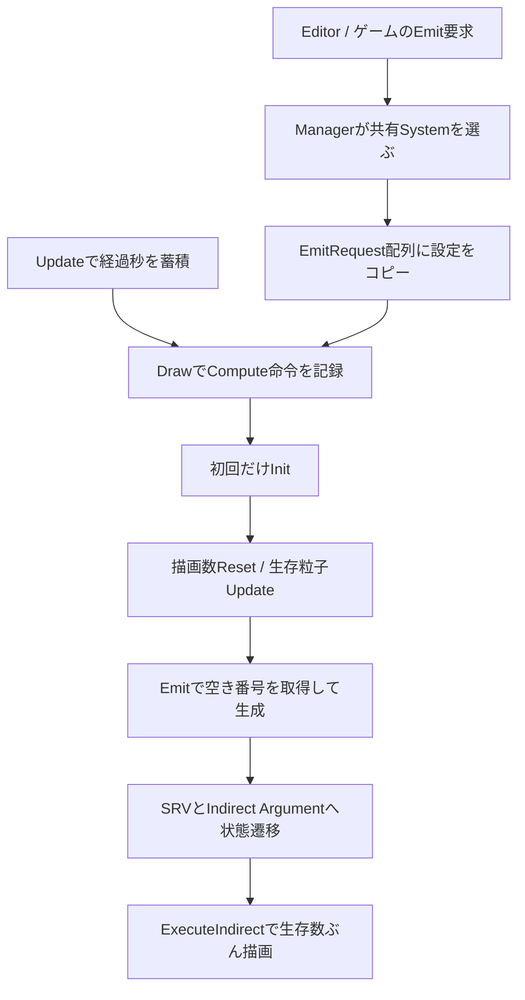

# GPU パーティクルをバッファと数式から理解する

[目次](00_目次と読み方.md) / [GPU パーティクル概要](04_GPUパーティクルエディター.md)。この章は `GPUParticleSystem`、`GPUParticleManager`、`ParticleCS.hlsl`、`GPUParticleVS/PS.hlsl` を照合した詳細解説である。以下の `N` はその System に確保した最大粒子数、`dt` は秒、位置はエンジンのワールド単位。1 ワールド単位を実世界の 1 m とする保証はコードだけからは得られない。

## 1. 「GPUで動く」の中身

粒子一つには現在位置、速度、残り寿命、初期寿命、色、大きさ、回転が必要になる。CPU 方式なら C++ の配列をループして更新する。現行 GPU 方式ではこの配列を GPU リソースに置き、Compute Shader の各実行スレッドが担当番号の粒子を読み、計算し、同じ場所へ書き戻す。

CPU が不要になるわけではない。CPU は JSON を読み、発生位置を決め、何個・いつ出すかを要求し、GPU が使うバッファとパイプラインを設定する。描画に必要な Camera、Depth、Texture も渡す。GPU は個々の粒子の更新と、生存粒子番号・描画数の作成を担当する。

現行 [`GPUParticleSystem::Update`](../engine/graphics/particle/GPUParticleSystem.cpp) が行うのは `totalTime_`、`frameDeltaTime_`、活動タイマーの加算。**Compute の Dispatch があるのは `Draw`**。関数名だけから Update が物理を完了させたと読んではいけない。



## 2. 五つのGPUバッファはそれぞれ何か

[`CreateBuffer`](../engine/graphics/particle/GPUParticleSystem.cpp) と [`ParticleCS.hlsl`](../Resources/shader/particle/ParticleCS.hlsl) の対応は次の通り。

| C++ のリソース | HLSL | 内容 | なぜ必要か |
| --- | --- | --- | --- |
| `particleBuffer_` | `particles : u0` | N 個の Particle 本体 | 位置や寿命を複数フレーム保持する。 |
| `freeListIndexBuffer_` | `gFreeListIndex : u1` | 空き番号スタックの末尾位置 1 個 | 次にどこから番号を取り出すかを全スレッドで共有。 |
| `freeListBuffer_` | `gFreeList : u2` | 再利用可能な粒子番号 | 死んだ粒子の場所を新しい粒子へ回す。 |
| `aliveParticleIndexBuffer_` | `gAliveParticleIndices : u3` | 生存粒子の番号列 | 生きた粒子だけを密な instance 番号で描く。 |
| `indirectDrawArgumentBuffer_` | `gDrawArguments : u4` | 4 個の uint | 頂点数、instance 数、開始頂点、開始 instance。 |

「密な番号列」とは、粒子本体の番号が `[2, 7, 90]` と飛んでいても、描画の 0 番目が粒子 2、1 番目が粒子 7、2 番目が粒子 90 を参照するということ。粒子本体を毎回先頭へ移し替える必要がない。これを生存リストへの**コンパクション**と捉えられる。この実装は並列 prefix sum を使った方式ではなく、原子的なカウンタ加算で末尾を確保する方式。

GPU Resource はデータの実体、UAV / SRV はアクセスの仕方を表す View。同じ `particleBuffer_` に UAV と SRV を作り、Compute からは書ける形で、Vertex Shader からは読む形で使う。二つの粒子配列を持っているという意味ではない。

## 3. CPUとHLSLのレイアウトがずれると何が起きるか

`Particle` のメンバー順は C++ と HLSL で一致する必要がある。GPU は C++ のメンバー名を知っておらず、「先頭から何バイト目」を読む。C++ に値を追加して HLSL を直さないと、色を速度として読むなどの破損が起こる。`StructureByteStride` も `sizeof(Particle)` に合わせている。

更新設定の `CSConfig` は Constant Buffer で、`alignas(256)` を指定する。バッファの 0 番区画は Update 用、1 番以降は Emit 要求用。C++ は `baseAddress + (i+1)*sizeof(CSConfig)` を CBV アドレスとして渡す。同じアドレスへ全要求を順に書くだけでは、後で実行する GPU が最後の設定しか見ないので、要求ごとの区画が必要になる。

メンバーの型、並び、パディング、定数バッファの配置境界は別々に確認する。`float3` と `float` を 16 バイトのまとまりに置くのはこの配置を読みやすくするため。`alignas(256)` を付ければ内部の全メンバーが自動的に HLSL と一致するわけではない。

## 4. 空きスロットを並列に取り合う問題

初期化では全粒子の寿命を 0 にし、`gFreeList[i]=i`、末尾位置を `N-1` にする。N=4 なら空き番号は `[0,1,2,3]`、末尾は 3。

発生処理は `InterlockedAdd(gFreeListIndex[0], -1, freeListPos)` を呼ぶ。**加算前の値が `freeListPos` に返る**。二つのスレッドが同時に発生しても、一方は 3、他方は 2 を取り出すため同じ番号を使わない。普通の「読む→1引く→書く」を別々に行うと、両者が 3 を読んで同じ粒子を上書きしてしまう。ここが **atomic operation（原子的操作）** の役割。

空きがなく古い値が負なら発生を諦め、カウンタを 1 戻す。死んだ粒子は `InterlockedAdd(..., 1, old)` で空き位置を確保し、`gFreeList[old+1]` へ自身の番号を返す。番号の貸出と返却であり、GPU メモリの確保・解放を毎粒行うわけではない。

ただし一つのカウンタへ多数のスレッドが集中する。原子的操作は正しさを守るが無料ではない。グループ単位でまとめて確保する方式も考えられるが、現行は個々の加算方式。空きリストの配列順と描画リスト順はスレッド実行順に依存し、半透明の奥行き順ソートにはなっていない。

## 5. Dispatchの数は粒子数と同じではない

Emit / Update は `[numthreads(256,1,1)]`。CPU の `Dispatch((count+255)/256,1,1)` は **256 個のスレッドを含むグループ**を必要数起動する。例えば 1000 粒子なら 4 グループ＝1024 スレッド。余分な 24 スレッドは Shader 冒頭の `index>=count` 判定で処理を終える。Init は 1024 スレッドのグループを使うため式の分母も違う。

Update は生存数ではなく**容量 N 全体**へ Dispatch し、各スレッドが寿命を検査する。Indirect Draw で描画数を減らしても、更新側の走査費用まで同じ割合で減るわけではない。容量の自動見積りや非活動 System のスキップにはこの意味もある。

## 6. 一粒の運動方程式

通常更新は順に、寿命を dt 減らし、重力・風・乱流・Field で速度を変え、減衰を掛け、最後に位置を更新する。簡略化すると以下。

```text
v ← v + (gravity + wind + noiseForce + fieldForce) × dt
v ← v × clamp(1 - drag × dt, 0, 1)
x ← x + v × dt
```

位置に使うのは**更新後の速度**なので、加速度を加えてから位置を積分する形は半陰的 Euler 型。解析解を毎回解く方式ではない。dt が大きいほど誤差も変わり、`drag*dt>=1` なら減衰係数が 0 になって速度が止まる。

`envWind` は名前から風速に見えるが、現行式では加速度として足す。`envTurbulence` は位置と時間を種にした擬似乱数ベクトルを速度へ加える。流体の速度場を解く Navier–Stokes シミュレーションや、発散ゼロを構成した Curl Noise ではない。ノイズによる揺らぎとして理解する。

Field の距離減衰は `a=(clamp(1-distance/radius,0,1))^falloff`。中心近くは強く、半径外は 0。Attract は中心向き、Repulse は逆向き。Vortex はワールド Y 軸と中心方向の外積から接線方向を作り、少し中心向きを混ぜる。`fieldPosition` は Emit 時に `emitPos+offset` として粒子へコピーするので、後から発生源を動かせば既存粒子の吸引中心も自動追従する、とは限らない。

## 7. 発生形状の実装上の意味

| 形状 | 実際にしていること | 見た目と注意点 |
| --- | --- | --- |
| Box | 各軸に -1～1 の乱数 × `emitArea` を足す | emitArea は全幅ではなく半幅。 |
| Sphere | 乱数ベクトルを正規化し、半径へ乱数を掛ける | 球内の体積一様分布とは異なる。半径が一様なら中心寄りの密度が上がる。 |
| Cone | 円板半径に `sqrt(random)`、角度に一様乱数を使い、速度方向の基底へ変換 | `shapeAngle` は度を radians に変換し tan を取る。全開き角という読み違いに注意。 |
| Mesh | 頂点を一つ選び、骨重みと World 行列で位置を変換 | 三角形面積に応じた表面一様サンプリングではない。頂点密度の高い部分に偏る。 |
| Heart | sin / cos のハート曲線へノイズ幅と奥行きを付ける | 3D のハート立体モデルから放出する処理ではない。 |

Mesh は ByteAddressBuffer を使い、位置・重み・骨番号を決まったバイトオフセットから読む。別レイアウトの頂点バッファを渡しても Shader は自動判別しない。EmitRequest の `vb` は借用ポインタなので、要求を出した瞬間だけ存在すればよいのではなく、GPU が参照を終えるまで資源の寿命が必要。

## 8. 深度衝突はカメラから見える面に対する近似

移動後の粒子位置を ViewProjection で Clip 座標へ変換し、w で割って NDC、さらに画面 UV に直す。その UV の背景深度と粒子深度を比較する。背景より奥に入り、深度差がコード内の閾値内なら衝突候補となる。

背景のその点と隣の X / Y ピクセルの深度から、逆 ViewProjection を使って三つの World 位置 `p0,p1,p2` を復元する。`cross(p2-p0,p1-p0)` が近似面法線。法線を速度と逆向きへ揃え、`reflect(v,n)=v-2 dot(v,n)n` で反射する。反射係数 `restitution` と XZ 方向の追加減衰を掛ける。

これは **screen-space collision**。CPU の CollisionManager と同じ接触判定ではない。画面外、手前の物体に隠れた面、深度を書かない透明物体を認識できない。輪郭付近では隣のピクセルが別の物体で法線が不自然になることもある。深度差 0.05 は device depth 上の値で、一定のワールド距離ではない。装飾粒子の跳ね返りとして便利だが、ゲームの命中判定に使う根拠にはならない。

## 9. 生存リストからIndirect Drawへ

`ResetDrawArgumentsCS` は引数を `[4,0,0,0]` にする。4 は一粒を構成する quad の頂点数、二番目は instance 数。生存粒子は `InterlockedAdd(gDrawArguments[1],1,slot)` で描画順番を得て、`gAliveParticleIndices[slot]` へ本体番号を保存する。

`ExecuteIndirect` は引数バッファを読んで描画する。CPU が N 個の寿命を読み戻して数える必要がない。Vertex Shader の `SV_InstanceID` は本体番号ではなく、生存リストへの番号である。ここを直接 `particles[instanceID]` にすると、死んだ粒子を読んだり別の粒子を描いたりする。[Microsoft の Indirect Drawing](https://github.com/MicrosoftDocs/win32/blob/docs/desktop-src/direct3d12/indirect-drawing.md)はコマンドシグネチャと引数配列の約束を確認する補助資料。

Compute の書込後は UAV Barrier で依存を順序付ける。描画へ移るときは粒子と生存リストを Shader の読み取り状態へ、引数を Indirect Argument 状態へ切り替える。**atomic がカウンタを守ること、UAV Barrier が Dispatch 間を同期すること、Transition が用途を切り替えることは別の役割**。[UAV Barrier の仕様](https://learn.microsoft.com/en-us/windows/win32/api/d3d12/ns-d3d12-d3d12_resource_uav_barrier)も参照。

## 10. 板なのに粒子に見える理由

[`GPUParticleVS.hlsl`](../Resources/shader/particle/GPUParticleVS.hlsl) は固定の四頂点を粒子の大きさで拡縮し、回転させ、Camera の逆 View 行列から作る Billboard 行列でカメラへ向ける。その板へ透明部分を含む画像を貼ることで、丸い光や煙に見える。球体の Mesh を一粒ずつ描いているわけではない。

速度に合わせる設定は、速度を Camera の右・上方向へ内積で投影し、`atan2` で画面上の角度を求める。速さに応じて横幅を伸ばせば細い流線になる。現行 `particleType=Trail` もこの伸長 quad の経路であり、過去の位置列をつないだ Ribbon Mesh と同じ仕組みではない。

Pixel Shader は手前の深度を直接読み、粒子が背景より奥なら discard する。この Pass は DSV を束縛しないため手動で遮蔽を判定する。Soft Particle は透視・正射影に対応する射影行列の式で両方の深度を線形な視点距離へ戻し、`alpha *= clamp((zBackground-zParticle)/fadeDistance,0,1)` とする。接地境界を薄くし、板が壁へ刺さる硬い線を目立ちにくくする技術。

## 11. シークの正確な限界

Editor は Reset 後に 1/60 秒ずつ Manager を呼ぶ。しかしその中で GPU Dispatch は行わない。次の Draw でまとめて発生し、`initialAge=totalTime-requestTime` を渡す。Shader は `x+=v*age+0.5*(gravity+wind)*age²`、`v+=(gravity+wind)*age`、`v*=exp(-drag*age)` で近似する。

通常更新の線形減衰と復元の指数減衰は一致しない。乱流、Field、途中の深度衝突はこの近似式に含まれない。さらに GPU Editor のシークループ自身は、通常フレームのローカルな Emit 間隔処理を毎刻み実行しない。**スライダーで見える状態が、先頭から連続再生した同時刻と必ず一致するわけではない。** 正確な履歴再現が必要なら GPU 更新をステップごとに記録するか、状態を保存して復元する設計が必要になる。これは改善案であって現行機能とは区別する。

## 12. 共有と容量を理解すると調整しやすい

Manager のキーは Texture / Blend だけでなく Sprite Sheet、向き、伸長、照明、容量等も含む。同じキーなら複数発生源が一つの System を共有できる。色や重力は発生時に各 Particle の `mem*` へ保存される。一方、描画設定は System 全体、衝突設定は `lastConfig_` を通じて更新へ渡る。設定によって作用範囲が違う。

自動容量はループ時に概ね `emitCount*(ceil(life/interval)+2)`、単発は `emitCount*6` を見積もり、256 から増やして上限 10000 と LOD 制限に収める。安全保証ではなく余裕を持った見積り。見えない粒子があるときは容量不足、Emit 要求 256 件上限、距離 LOD、深度遮蔽、透明度、活動タイマーを別々に確認する。

学習の到達点は「Compute Shader という名前を言える」ことではなく、発生要求一つについて、設定がどこへコピーされ、どの空き番号を取り、どの式で動き、何番の instance として描かれるかを追えることにある。
