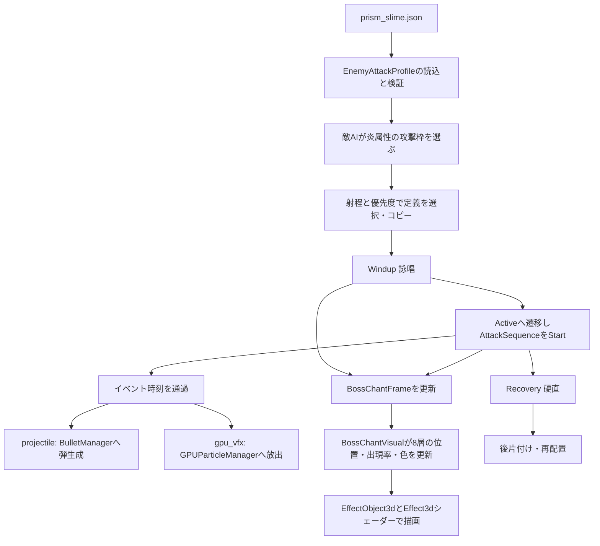

# プリズム炎連射と魔法陣を、データから描画まで追う

[目次](../00_目次と読み方.md) / [共通攻撃シーケンス](14B_共通攻撃シーケンスの制作と移行.md)

2026-10-07。対象はプリズムスライムの `fire_fan`（炎の扇状連射）と、その詠唱に使う `BossChantVisual`。この章は実際のコードとJSONを読んで説明している。移行したのは炎連射の発射イベントで、結晶槍・雷・風・召喚まで共通命令へ移したわけではない。

## 1. 画面のどの部分に、どの技術が使われているか

| 見えるもの・動作 | 技術名 | この実装で行っていること |
| --- | --- | --- |
| 正面に浮かぶ炎の紋章 | テクスチャ付き平面メッシュ | 透過PNGを4頂点・2三角形の板へ貼る |
| 紋章が円周に沿って完成する | 極座標によるリビール、ピクセル破棄 | UVから角度を求め、進行率より先の画素を `discard` する |
| 紋章の発光の縁 | レイヤー合成、加算ブレンド | 同じ紋章を少し大きくして重ねる |
| 足元の柔らかい輪 | アルファ付きテクスチャ、回転変換 | `soft_ring.png` を地面付近へ置く |
| 足元を流れる細い光 | プロシージャルシェーディング、極座標、三角関数 | 半径と角度に `sin`・`pow`・`exp` を適用して筋を作る |
| 足首・胴体の外側を回る帯 | プロシージャルメッシュ、螺旋、UV上の輝度マスク | C++で立体の帯を作り、シェーダーで明るい部分を流す |
| 周囲に出る小さな火の粒 | GPUパーティクル、方向付きエミッション | CPUで発生位置と方向を決め、共通GPU粒子システムへ渡す |
| 5発が順に広がる | データ駆動のイベント列、時刻順ディスパッチ | JSONの10命令から、5発の弾と5回の発射光を生成する |
| 弾本体の炎 | ビルボード、fBmノイズ、焼き込み画像、深度フェード | カメラ向きの板に丸い炎の模様を計算し、地形との境界を薄くする |
| 詠唱→発射→硬直 | 有限状態機械（FSM） | 敵の状態が演出と共通命令の開始・終了を管理する |

紋章の細かい線そのものはPNGに描かれている。円周ワイプはその画像の表示範囲を計算する技術である。足元の流れや帯の光には別の数式を使う。魔法陣全体を「レイマーチングで描く」と理解すると、実装との対応がずれる。

## 2. 最初に開くファイル

| ファイル | まず読む場所 |
| --- | --- |
| [`prism_slime.json`](../../Resources/json/enemy_attack/prism_slime.json) | `fire_fan.sequence`。発射時刻、角度、位置、外観 |
| [`EnemyPrismSlime.cpp`](../../game/actor/enemy/boss/prism/EnemyPrismSlime.cpp) | `SelectFireFanDefinition`、`StartAttack`、`UpdateWindup`、`UpdateActive` |
| [`AttackSequenceData.h`](../../game/actor/combat/AttackSequenceData.h) | 命令データ、検証、時計 |
| [`AttackSequence.h`](../../game/actor/combat/AttackSequence.h) | `ResolveAttackSequenceEmission`。座標と速度の式 |
| [`AttackSequence.cpp`](../../game/actor/combat/AttackSequence.cpp) | `Update`の条件、`Execute`の弾と粒子生成 |
| [`BossChantVisual.h`](../../game/actor/enemy/boss/core/BossChantVisual.h) | `Start`、`Update`、`Draw`。魔法陣を構成する8層 |
| [`EnemyPrismSlime.Attacks.cpp`](../../game/actor/enemy/boss/prism/EnemyPrismSlime.Attacks.cpp) | `GetChantSigilCenter`、`UpdateChantSigilVisual`。術者姿勢から表示器へ渡す情報 |
| [`EffectObject3d.cpp`](../../engine/graphics/effect/EffectObject3d.cpp) | `LoadFromJson`、`GeneratePlaneVertices`、`GenerateSlashVertices`、`Draw` |
| [`Effect3d.PS.hlsl`](../../Resources/shader/effects/Effect3d.PS.hlsl) | 円周リビール、`proceduralType == 7`、`chantFlowStrength`、`chantRibbonStrength` |

`BossChantVisual`はヘッダー内に実装を持つ。対応する `.cpp` を探す必要はない。

## 3. 一回の攻撃で実際に何が呼ばれるか



AIは「いつ、どの属性枠を使うか」を決める。共通ランタイムは「その枠の中で、何秒に何を出すか」を実行する。魔法陣表示器は術者の位置と詠唱進行率を受け取る。エディターは同じ敵を生成してこの流れを進める。

### 現在の時間配分

既定の `fire_fan` は以下の設定。

| 区間 | 長さ | 起こること |
| --- | --- | --- |
| Windup | 0.65秒 | 照準、紋章の形成、粒子、予告 |
| Active | 0.52秒 | 共通命令の再生、魔法陣の減衰 |
| Recovery | 0.48秒 | 硬直。魔法陣を非表示にする |

再使用時間2.9秒、再配置やAIの待ち時間もあるので、これらの合計が次回発射までの周期を完全に表すわけではない。

**プリズムのシーケンスの時刻0は、詠唱が終わってActiveへ入った瞬間。** 炎スライムと炎コピーの接続では攻撃開始が時刻0である。`AttackSequence`自身はWindupを知らず、呼び出し元が `Start` した瞬間を原点にする。予備動作の時間を変えてもプリズムの発射間隔を一緒に書き換える必要がない。

`UpdateWindup`でActiveへ入った同じ更新中に `Start` し、時刻0の弾を出す。旧専用処理は次のActive更新で最初の弾を出していたため、状態遷移に対する最初の発射は最大で通常の1更新ぶん早くなる。5発の設定間隔と位置・角度・速度は維持している。FSM全体にフレーム超過時間を繰り越す変更は今回行っていない。

シーケンス長をActive設定より長くした場合、Activeもその長さまで延ばす。魔法陣のフェード開始も同じ長さから計算する。最後の命令を出す前に硬直へ進んでしまうことを防ぐ。

## 4. 「コードに5発と書く」処理をどう置き換えたか

旧 `FireNextFanProjectile` は、C++の `actionIndex_` と定数から角度を求め、`UpdateActive`が0.095秒ごとに呼んでいた。新しい既定JSONでは次の時刻に命令を置く。

| 発射番号 | Active開始から | 水平角度 | 上向きの追加位置 |
| --- | --- | --- | --- |
| 1 | 0.000秒 | 約-14.897度 | 0.20 |
| 2 | 0.095秒 | 約-7.448度 | 0.10 |
| 3 | 0.190秒 | 0度 | 0 |
| 4 | 0.285秒 | 約7.448度 | 0.10 |
| 5 | 0.380秒 | 約14.897度 | 0.20 |

各時刻には `projectile` と `gpu_vfx` を1件ずつ置いている。弾の生成と発射光の生成は別命令なので、片方だけ消す、時刻をずらす、異なるプリセットにする、といった編集ができる。

先頭の弾命令を抜き出すと次のようになる。

```json
{
  "time": 0.0,
  "operation": "projectile",
  "offset": [0.0, 0.2, 0.0],
  "sizeOffset": [0.0, 0.48, 0.48],
  "yawDegrees": -14.8969027,
  "aimAtTarget": false,
  "distanceSpeedScale": 1.55,
  "distanceSpeedBias": 4.0,
  "verticalSpeed": 0.45
}
```

`offset`と`sizeOffset`はいずれも右・上・前の順。前者はワールド長さ単位、後者は術者の基準サイズに掛ける係数。コードでは距離の単位をmとしてUI表示している。`yawDegrees`は度、内部の三角関数に入れるときラジアンへ変換する。

### 時刻順ディスパッチ

`AttackSequenceClock::Start`は定義をコピーし、`stable_sort`でイベントを時刻順に並べる。同時刻ならJSON配列の順番を維持する。更新では次の未実行イベントを指す番号を進める。

```cpp
while (次のイベントが存在する && 次の時刻 <= 経過時間) {
    // 条件を評価し、実行またはスキップして、次のイベントへ進む。
}
```

この形なので、重いフレームで0.30秒進んでも、通過した0.095、0.190、0.285秒の命令を取りこぼさない。ただし通過した命令はその更新でまとめて生成する。過去の発射時刻に戻して各弾の飛翔位置まで補正する仕組みではない。

`condition`は常時、接地中、空中、標的が射程内から選ぶ。射程条件はイベント時の術者と標的の水平距離で評価する。`stopOnFalse`なら後続命令も中止する。中止するのは命令列であり、すでに飛んだ弾を消したり、ボスの硬直を必ずその瞬間に終わらせたりする機能ではない。

## 5. 発射位置と速度の数式

処理は `ResolveAttackSequenceEmission` にまとまっている。描画に依存させていないため、旧発射式との一致をテストから確認できる。

### 5.1 前方向と右方向

術者の前方向のYを0にして正規化する。水平角度をθとして、Y軸回転を適用する。

```text
Fx = 元のFx * cosθ + 元のFz * sinθ
Fz = 元のFz * cosθ - 元のFx * sinθ
右方向 R = (Fz, 0, -Fx)
```

前方向の長さがほぼ0なら `(0,0,1)` を使い、ゼロ除算を避ける。

### 5.2 術者の大きさを加味した発射口

```text
発射位置 = 術者位置
         + R * (offset.right   + 基準横幅 * sizeOffset.right)
         + Y * (offset.up      + 基準高さ * sizeOffset.up)
         + F * (offset.forward + 基準前幅 * sizeOffset.forward)
```

プリズムは基準横幅・前幅に `baseScale_.x`、基準高さに `baseScale_.y` を渡す。攻撃アニメーションの潰れや伸びを発射口へそのまま掛けると弾道まで揺れるため、基準スケールを使う。ほかの接続先は、明示しなければ基準サイズ `(1,1,1)` を使う。

`aimAtTarget=false`なら、上で計算した前方向へ撃つ。trueなら発射口から標的位置＋高さ補正へ向かうベクトルを正規化し、その方向へ水平角度を加える。5発すべてを標的へ向けると扇の形が変わるため、今回の既定データではfalseにしている。

### 5.3 距離によって速さを変える

```text
速度の大きさ = clamp(照準距離 * 1.55 + 4.0, 13.0, 28.0)
弾の速度ベクトル = 発射方向 * 速度の大きさ + (0, 0.45, 0)
```

距離9なら `9 * 1.55 + 4 = 17.95`。遠すぎても28を超えない。プリズムは照準を固定した距離を速度計算に使うため、連射中に標的が動いても各弾の初速が突然変わらない。射程条件の現在距離とは用途を分けている。

倍率0、または標的情報がない接続では最高速度を使う。速度への加算値だけで固定速度を指定する設計ではない。固定速度にしたいなら倍率0と `movement.maxSpeed` を設定する。

### 5.4 同時拡散と時間差連射

`count=3, spreadDegrees=30`なら、同時に-15、0、15度へ3発出す。`yawDegrees`はその発射の中心方向。今回の5発は各命令が `count=1` で、時刻をずらした時間差連射である。

## 6. 弾の外観と衝突も何を使っているのか

`AttackSequence::Execute`は共通の `BulletVisualConfig` を作る。炎スタイルはマテリアル11、`effectType=1`の丸い炎、軌跡と命中時の粒子を渡す。今回、プリズム専用関数にあった数値を `sequence.fireAppearance` に移した。

| 項目 | プリズムの値 | 役割 |
| --- | --- | --- |
| `color` | `[1, 0.30, 0.055, 0.98]` | 炎の色と透明度 |
| `emissive` | 3.0 | 旧設定と同じ値を材質に保存する。現在の炎PSはこの値を直接参照しない |
| `visualScale` | 1.22 | 弾オブジェクトのScale。表示と球判定の両方に作用する |
| `effectScale` / `softness` / `intensity` | 1.18 / 0.38 / 1.08 | 共通の炎エフェクトへ渡す倍率・柔らかさ・強度 |
| `billboardScale` | 0.74 | カメラ向きの炎の板の大きさ |
| `trailInterval` / `trailSpeedScale` | 0.025秒 / 1.16 | 軌跡の粒子を出す間隔と速度倍率 |

軌跡には `fireball_trail_flame` と `fireball_trail_embers`、命中には `fireball_impact_flame` と `fireball_impact_sparks` を共通C++側で選ぶ。これらの名前の選択まで、今回の攻撃JSONの外観欄に出したわけではない。粒子自体の色や形は、それぞれのGPUパーティクルプリセットで調整する。

`Bullet::ConfigureVfx`には軌跡間隔の下限0.01秒、軌跡速度倍率の下限0.05がある。UIもその下限に合わせている。球の設定半径は `targeting.radius` だが、[`Collider::GetRadius`](../../engine/component/Collider.cpp)がScaleの最大成分を掛けるため、この弾の実効半径は `radius * visualScale`。既定値では `0.48 * 1.22 = 0.5856` になる。判定を変えずに炎だけ大きくしたい場合は `effectScale` または `billboardScale` を調整する。今回の共通命令は球弾であり、プロフィールの形状欄をboxに変えるだけで箱弾へ切り替わるわけではない。

陣営から接触カテゴリを取得する。敵所有なら `enemy_attack` と、対象 `player | ground`。プレイヤー所有なら `player_attack` と、対象 `enemy | ground`。ダメージと燃焼時間・周期・周期ダメージは攻撃定義から渡す。炎に見えるだけでダメージを実装しているわけではなく、弾の衝突と状態異常の経路が別にある。

### 6.1 この火球はどう描くか：ビルボードの炎

[`BulletManager`](../../game/system/BulletManager.cpp)のマテリアル11は `DrawFire`へ進み、[`MeshRenderer::DrawFireWithWvp`](../../engine/graphics/3d/MeshRenderer.SpecialMaterial.cpp)が代理メッシュを選ぶ。`effectType=1`は4頂点の板を使う。 [`Fire.VS.hlsl`](../../Resources/shader/materials/Fire.VS.hlsl)がカメラから火球中心への方向、その右方向、上方向を計算し、板をカメラへ向ける。これがビルボード。

板の範囲は概ね `最大軸Scale * billboardScale * effectScale` で決まる。頂点をノイズで少し揺らし、完全に静止した四角形にならないようにする。

[`Fire.PS.hlsl`](../../Resources/shader/materials/Fire.PS.hlsl)の `effectType < 1.5` 分岐は、中心からの半径とfBmノイズで輪郭を作る。太いノイズ、細かな割れ目のノイズ、時間の脈動、`fire_orb_mask.dds`の焼き込み画像を組み合わせ、`heat`、`core`、`ember`など見た目用の値を求める。ここでのheatは実際の温度を解く物理量ではない。

`TonalFireRamp`がheatに応じて暗い赤、橙、黄、白熱色へ補間する。高輝度値も出すので後段のBloomの素材になる。RGBの塗りつぶしだけでなく、ノイズによる色と透明度の差で炎らしい模様を作っている。明るさを直接調整するのは `effectIntensity` で、材質の `emissive` ではない。

背景深度より火球が奥ならピクセルを捨てる。また背景位置との距離差を0.12で割って透明度へ掛け、地面や壁との交差部分を柔らかくする。これは深度を使うソフトパーティクルに近い処理。背景Grab画像のUVをノイズで少しずらす画面空間の屈折も加える。手前の壁を歪み先から引き込まないよう、ずらした位置の深度も確認する。

体積を積分する `RenderFireVolume` へ進むのはeffectTypeが2、4〜7に相当する範囲である。今回の1はそこへ入らない。[体積炎のレイマーチング](../02_描画と演出/03A_体積炎のレイマーチング.md)は同じ炎系にある別経路の解説として読む。

## 7. 魔法陣はどういう部品からできているか

`BossChantVisual::Start`は最大8個の `EffectObject3d` を生成する。

| オブジェクト | 元のプリセット | 置き場所・役目 |
| --- | --- | --- |
| `sigil_` | `effect_boss_chant_fire.json` | 術者正面の紋章本体 |
| `glow_` | 同じ紋章JSON | 正面の発光補助。少し大きく、少し手前へずらす |
| `floor_` | 同じ紋章JSON | 地面上でゆっくり回る紋章 |
| `groundLight_` | `effect_boss_chant_ground_light.json` | 足元の柔らかい光の輪 |
| `groundCore_` | `effect_boss_chant_ground_core.json` | 極座標で流れる光の筋 |
| `footRibbon_` | `effect_boss_chant_foot_ribbon.json` | 足首付近の短い立体の帯 |
| `risingLight_` | `effect_boss_chant_rising_light.json` | 胴体外側の上昇する帯 |
| `risingLightCounter_` | 同じ上昇帯JSON | 逆方向に回す補助の帯 |

最初の3層は必須。読み込みに失敗した場合は全体をリセットして開始失敗を返す。足元・帯の補助層は、存在するものだけ更新する。各層は `unique_ptr` で表示器が所有するため、敵の攻撃終了や再生成で表示器を破棄すれば、この所有物も破棄される。

設定ファイルは [`Resources/json/effect`](../../Resources/json/effect) にあり、元の紋章画像は [`boss_chant_fire.png`](../../Resources/sprite/effect/boss_chant/boss_chant_fire.png)。JSONにPNG全体が埋め込まれているのではなく、画像のパスと表示パラメーターが保存されている。

## 8. 正面の紋章：テクスチャと円周リビール

### 8.1 画像を貼る板を作る

紋章JSONは `ProceduralType=7`、`PlaneSize=[2.4,2.4]`、`MeshSegments=1`。`UpdateProceduralMesh`から `GeneratePlaneVertices`へ進む。XZ平面上に4頂点を作り、UVを0〜1に割り当て、6個のインデックスで2三角形を描く。

これが「プロシージャルメッシュ」。頂点を外部モデルから読む代わりにC++の式で生成するという意味。紋章の絵柄まで頂点で刻んでいるわけではない。

術者正面へ立てる回転は `MakeUprightRotation` の `(π/2, atan2(Fx,Fz), 0)`。地面用の板を起こして攻撃方向へ向ける。カメラの方向を使っていないので、カメラが横へ回れば板を横から見ることになる。

### 8.2 円周に沿って見える範囲を増やす

紋章JSONの `EnableReveal=true, RevealMode=2` が、シェーダーの `enableReveal == 2` に対応する。

```hlsl
float2 centeredUv = input.uv - float2(0.5f, 0.5f);
float sweep = atan2(centeredUv.x, -centeredUv.y) / 6.2831853f;
if (sweep < 0.0f)
    sweep += 1.0f;
if (sweep > saturate(revealProgress))
    discard;
```

UVの中心を原点にすると、各画素が中心のどちら側にあるかを角度で表せる。`atan2`はX・Yの符号も含めて角度を返す。2πで割ると一周が1となり、負の値へ1を足して0〜1へ揃える。

この式では上が0、右が約0.25、下が約0.5、左が約0.75。進行率0.25なら上から右まで、0.5なら半周が表示対象となる。円の線を描き足すのではなく、画像の未表示部分をピクセル単位で捨てている。

`ProceduralType=7`の通常経路は `alphaMask = mainColor.a`。PNGの透明部分を維持するので、板の四角い輪郭を隠せる。`UseTextureColor=true`ではPNGのRGBも使い、色付き紋章の配色を残す。

### 8.3 時間の割合を、そのまま出現率にしない理由

`BossChantVisual::Update`は詠唱進行率 `p` から次を作る。

```text
S(x) = x²(3 - 2x)                       // SmoothStep
assembly = S(clamp((p - 0.04) / 0.64))  // 形成
charge   = S(clamp((p - 0.68) / 0.27))  // 形成後の溜め
```

開始直後の4%は準備、68%付近で形成を終え、その後に明るさを増す。SmoothStepは始点・終点で変化が緩くなる補間。突然一定速度で出始めたり、完成時に急停止したりする印象を抑える。

`completeAtRelease=true`の利用者は別の分岐で、詠唱進行率をそのまま使って最後まで形成を続ける。プリズムの炎は既定falseの経路である。

## 9. 光を重ねる：透明度、発光、深度

### 9.1 フェードと瞬間の発光

Activeへ入ってからの経過時間を `t` とすると、フェードは次の式。

```text
fade = 1 - S(clamp((t - fadeStart) / 0.24))
releaseFlash = exp(-14 * t)
```

既定Active0.52秒なら `fadeStart=0.28`。最後の0.24秒で薄くなる。`releaseFlash`は発射直後1で、時間とともに急速に小さくなる指数減衰。明るさを滑らかに落とすための数式で、光の物理シミュレーションを行っているわけではない。

本体の透明度は `(0.22 + assembly*0.43 + charge*0.15) * fade * presetAlpha`。紋章JSONのalpha0.72はこの `presetAlpha` に入る。JSONで指定した透明度に、攻撃進行に応じた係数を掛けている。

脈動は `1 + sin(time * (3 + charge*3)) * 0.025 * assembly`。規則的な2.5%程度の拡縮で、静止画像に小さな動きを加える。ここでの `time` は敵から渡された時間なので、命令列の開始からの秒数とは別である。

### 9.2 通常ブレンドと加算ブレンド

紋章本体・床のJSONは `BlendMode=1`、つまり通常ブレンド。補助の `glow_` と足元・帯の層はC++が `kAdd` に設定する。RGBの合成式は概略次のとおり。

```text
通常: 出力 = 今回の色 * 今回のα + 背景色 * (1 - 今回のα)
加算: 出力 = 今回の色 * 今回のα + 背景色
```

加算なら背後を暗くせずに光を重ねられる。一方、層を増やしすぎると白く飽和して輪郭が読めなくなる。現在の表示器は正面・床・胴体で位置と透明度を分け、顔を覆わないよう帯の高さを抑えている。

`glow_`は本体より1.02倍大きく、前方向へ0.012だけずらす。同じ深度に重ねることによる干渉を抑えつつ、縁に色付きの光を置く。

### 9.3 深度設定は呼び出し順まで読む

[`Object3dCommon::CreateEffectPipeline`](../../engine/graphics/3d/object/Object3dCommon.cpp)はカリングなし、深度テストあり、HDR形式の描画先を設定する。裏側の三角形も描けるが、板を真横から見た際に厚みが生まれるわけではない。

この関数には「深度書き込みなし」を設定する行がある。ただし、その後に呼ぶ [`GraphicsPipelineBuilder::SetBlendMode`](../../engine/graphics/core/GraphicsPipelineBuilder.cpp) が値を上書きする。現在の最終設定では通常ブレンドは深度書き込みあり、加算ブレンドはなし。コメントだけで「魔法陣は全層とも深度を書かない」と判断できない箇所である。今回この共通パイプラインの挙動は変更していない。

## 10. 足元の光：画像の輪と数式の流れを分ける

`groundLight_`は `soft_ring.png` を使う平面。`groundCore_`は白画像と `ChantFlowStrength=1` を使い、シェーダーで光の模様を作る。

`groundCore_`の座標変換は次の形。

```text
p = (UV - 0.5) * 2
r = length(p)
θ = atan2(p.y, p.x)
歪ませた半径 = r + (ノイズ - 0.5) * 0.055
位相 = θ * 3 - 歪ませた半径 * 13 + 時間 * 角速度
筋 = pow(saturate(0.5 + 0.5 * sin(位相)), 12)
```

角度方向と半径方向を同じ式に入れるため、同心円だけでなく巻くような筋になる。時間を位相へ足すと筋が流れる。`pow(...,12)`は明るい山を細く絞るために使う。

さらに逆方向の筋、`exp(-距離²)`による柔らかい外周、中心の淡い光、床を薄く照らす帯を加える。内側・外側は `smoothstep` で減衰させ、四角いメッシュの縁が出ないようにする。

ノイズは、外部ノイズ画像が有効なら画像を読む。それ以外では `fbm_light` を使う。これは値ノイズを周波数2倍・振幅半分にして3層重ねる簡易fBm。大きな揺らぎと細かな揺らぎを組み合わせる。本体紋章のType7は画像alphaを使うが、足元の光はこのノイズを半径の揺れにも使う。

ここでの動きは画素の明るさを変えて作る。流体シミュレーションや実際の地形を照らす動的ライトを、この式が生成しているわけではない。

## 11. 立体の帯：螺旋メッシュと流れる明るい部分

足首のプリセットは `ProceduralType=2`、`SlashAngle=410`度、`SpiralPitch=1.0`、`MeshSegments=88`。上昇帯は420度、ピッチ2.65、80分割。

`GenerateSlashVertices`は角度を少しずつ増やしながら、内側・外側の半径へ頂点を置く。高さもピッチに沿って増やす。各区間には内側、中央上、中央下、外側の4頂点があり、隣の区間と三角形で接続する。通常の平面スプライトと異なり、立体的な帯の形状を持つ。

UVのUは帯に沿った進行、Vは帯の幅を表す。シェーダーは `ChantRibbonStrength=1` のとき、幅方向の中心からの距離 `d` に対して次の値を作る。

```text
柔らかい帯 = exp(-d² * 14)
細い芯     = exp(-d² * 85)
移動する明部 = 0.16 + 0.84 * pow(saturate(0.5 + 0.5*sin(U*16 - 時間*5)), 2.5)
```

柔らかい帯と細い芯を重ね、移動する明部を掛ける。両端も減衰させる。これにより、螺旋全体が均一な太い棒に見えることを抑え、短い光が流れているように見せる。

`BossChantVisual`はこのメッシュ全体もY回転させる。上昇帯は `time*1.65`、補助帯は `-time*1.20 + 2.3`。メッシュの回転とUV上の明部の移動を重ねるため、単に1枚の絵を回すより複雑な動きになる。

## 12. 魔法陣の位置はどう地面・術者に合わせるか

術者正面の中心は `GetChantSigilCenter` で計算する。

```text
中心 = 術者ワールド位置
     + 固定した前方向 * clamp(baseScale.x * 1.75, 1.7, 2.8)
     + (0, baseScale.y * 0.55 + 1.05, 0)
```

床位置は [`CombatGroundQuery::FindGroundPoint`](../../game/actor/combat/CombatGroundQuery.cpp)。サンプル位置の11上から24下へレイキャストし、`ground`カテゴリを対象に、自分を除外する。ヒットしなければ術者の高さへフォールバックする。

床の紋章はヒット位置＋Y0.075、光の層は＋Y0.16や0.17へ置く。地面と完全に同じ面へ重ねないためのオフセットである。取得した地面法線に沿ってメッシュを曲げたり、坂に投影するデカール処理をしたりはしていない。床の層は基本的に水平なので、傾斜や段差での見え方には制約がある。

術者の大きさはモデルのワールドAABB（軸に平行な包囲箱）と基準スケールから求める。これを表示器へ渡し、足元の輪や帯の半径・高さを決める。

## 13. 粒子は魔法陣のメッシュとは別に動く

炎詠唱は [`boss_chant_fire_motes.json`](../../Resources/json/gpu_particles/boss_chant_fire_motes.json) を使う。現設定は1回2粒、寿命0.43秒、`flame_soft.png`、途中で明るくなって最後に透明になる色変化。

`EmitGatheringMotes`では `cos`と`sin`で術者周囲の発生位置を作り、`fmod`で高さを繰り返し上げる。接線方向に上向き成分を足して `EmitDirected` に渡す。反対側や床付近にも発生点を置くため、片側だけに粒子が偏りにくい。

関数名にはGatheringとあるが、この関数自身が全粒子を紋章中心へ吸い寄せる物理計算をしているわけではない。コードで渡している主な方向は外周の接線＋上向き。既存の粒子がその後どう動くかは、GPUパーティクルの速度、抵抗、揺らぎなどの設定が決める。

詠唱粒子のCPU側発生間隔は `0.15 - charge*0.045` 秒。発射へ切り替わった瞬間には、`wasReleasing_`でエッジを検出して一度だけ発射粒子を出す。今回のシーケンスにある5回の銃口側の発射光とは別で、これは紋章中心の放出演出である。

GPU粒子のバッファ、Free List、Compute Shader、描画の詳細は[GPUパーティクルのメモリと計算](../02_描画と演出/04A_GPUパーティクルのメモリと計算.md)へ。CPUの魔法陣オブジェクトを破棄しても、すでに粒子管理へ渡した粒子は各自の寿命を持つ。

## 14. CPUの設定がGPUの画素になるまで

1. `EffectObject3d::LoadFromJson`がメッシュ形状、テクスチャ、マテリアル値を読む。
2. `BossChantVisual::Update`が各層のTransform、透明度、強度、出現率をそのフレームの値で更新する。
3. `UpdateLocalMatrix`と`UpdateWorldMatrix`で配置を反映する。
4. `DrawEffect`が現在のカメラを `RefreshRenderCameraData` で反映する。敵が内部所有する表示物なので、シーンの通常更新だけに依存させない。
5. `EffectObject3d::Draw`がPSO（描画パイプライン設定）を選択する。
6. CBV（定数バッファ参照）でWVP行列とマテリアル、SRV（GPUが読むリソース参照）でテクスチャを結びつける。
7. [`Effect3d.VS.hlsl`](../../Resources/shader/effects/Effect3d.VS.hlsl)が頂点をWVP変換し、UVをピクセル側へ渡す。
8. ピクセルシェーダーがリビール、画像・数式のマスク、色と強度、alpha閾値を計算する。
9. 通常・加算ブレンドで既存の画面へ重ねる。

プリセットに `EnableDistortion=false` とある紋章では、背景Grabテクスチャを使う歪み分岐は有効にならない。シェーダーに機能が存在することと、そのプリセットが機能を使うことは分けて読む。

## 15. エディターでどこを編集すればよいか

### 炎連射を派生させる

1. 敵攻撃プレビューでプリズムスライムの「炎の扇状連射」を選ぶ。
2. 「共通攻撃を追加・選択攻撃から複製」を押す。新しいIDが発行され、優先度が1上がる。
3. 「共通実行シーケンス」で時刻、水平角度、位置、条件、弾の外観を変える。
4. 弾と発射光を同じ口から出したい場合は、両イベントの時刻・位置・角度を揃える。
5. 「保存してプレビューへ反映」を押す。保存とキャッシュ無効化の後に対象を再生成する。
6. Playでも再生成された敵を使って確認する。実行中の攻撃定義はコピーなので、途中で保存しても進行中の一斉射を差し替えない。

通常AIでは炎属性枠を選んだとき、射程内の有効な敵シーケンスから優先度が高いものを使う。同値ならプロフィール内の先頭を優先する。プレビューは選択したIDを優先する。新しいJSON攻撃を増やしても、発射のために新しい `AttackKind` や個別のエディター分岐を増やす必要はない。

今回はプリズムの炎枠への接続である。炎の派生を複製しただけで、別のHPフェーズにも出現するAIルールや、新しい詠唱ポーズが自動追加されるわけではない。

### 魔法陣の見た目を調整する

メッシュエフェクトエディターで対応するeffect JSONを読み、紋章画像、平面サイズ、リビール、強度、帯の形、詠唱の光の流れなどを調整する。粒子はGPUパーティクルエディターで対応プリセットを編集する。

注意するのは **プリセットの値を読み込んだ後、表示器が毎フレーム何を上書きするか**。

| 変更したい内容 | 主な担当 | 反映の仕方 |
| --- | --- | --- |
| 紋章の模様・PNGの透明部分 | effect JSONとテクスチャ | 紋章3層で使う |
| 紋章の基準alphaとIntensity | effect JSON | 読み込んだ値へ進行率の係数を掛ける |
| 板の元サイズ、帯の分割数・ピッチ | effect JSON | 生成メッシュを変更する |
| 詠唱時間、発射時刻 | attack JSON | 敵のFSMと命令時計が使う |
| 紋章中心の位置、各層の毎フレームの回転・Scale | `BossChantVisual`と敵の姿勢接続 | プリセットのTransformをそのまま使わず上書きする |
| 詠唱陣に使うプリセットの選択、属性色 | `EnemyPrismSlime::StartAttack` | 今回はC++側に残る |
| 粒子一つの形・色・寿命 | gpu_particles JSON | 共通粒子管理が読み込む |

したがって、メッシュ単体プレビューで変えた配置が、そのままボスに付いた魔法陣の配置になるとは限らない。最終的な重なりは敵攻撃プレビューで確認する。今回の移行と資料では、共通表示器の存在と、表示器の組み合わせ設定がまだC++に残る点を両方明示している。

## 16. 中断・互換性・残っている専用処理

- JSONに追加フィールドがない既存の炎スライムは、従来と同じ既定値を読む。外観の省略値も以前の共通炎弾に合わせた。
- `sequence.enabled=false`のプリズム炎は、従来の `FireNextFanProjectile` 経路を使う。旧JSONのフォールバックを残している。
- 死亡、遭遇演出への切り替え、プレビュー再生成で呼ばれる `ClearPrismAttackVisuals` は、未実行の命令もキャンセルする。すでに発射された弾は弾管理が所有する。
- この命令系は一回のイベント列であり、Behaviour Tree、Lua、任意C++コードの実行環境ではない。命令種類を新設するときは共通C++処理が必要になる。
- AIの属性選択、敵固有の体の動き、詠唱中の定期放出、ほかの特殊攻撃の発生ロジックは専用C++に残る。
- 保存形式はversion 5。旧形式も既定値で読めるが、古いアプリで新項目を保存し直すと項目を落とす可能性があるため、旧アプリとの双方向編集まで保証するものではない。

## 17. 検証と読み方の注意

[`AttackSequenceTests.cpp`](../../tests/AttackSequenceTests.cpp)で、実際のプロフィールの読込、JSON往復、複製、時刻0、複数イベント通過、条件スキップ・中断、キャンセル、5発と発射光の回数を検証する。さらにプリズムの位置・角度・速度を旧式で計算した値と比較する。

これは数値と実行順の検証である。紋章が画面上で読みやすいか、敵の顔を覆わないか、坂で床の輪が埋まらないか、Play中に全弾が期待どおり衝突するかは、実画面の確認が必要。ビルドとこのテストだけを、視覚品質の確認済みという意味では使わない。

調べ直すときは、**見た目 → プリセット → 呼び出すC++ → 有効なシェーダー分岐 → 合成方法** の順で追う。同じシェーダー内に雷、帯、紋章があっても、全部の分岐を一つのエフェクトが使うわけではない。

### 今回の確認結果

- Development x64のコンパイル・リンク成功。最終ビルド後の再実行は追加コンパイルなし、約2.7秒で終了した。
- 上記のJSON・時計・プリズム発射式の回帰テスト成功。発射口と標的が重なり、前方向もゼロの場合の代替方向も確認した。
- 変更対象の日本語ファイルはUTF-8として読み取れ、置換文字U+FFFDなし。更新した4つのMarkdownのローカルリンクは参照先が存在した。
- 今回の変更後に実機のPlayや編集画面を操作した目視検証は行っていない。
